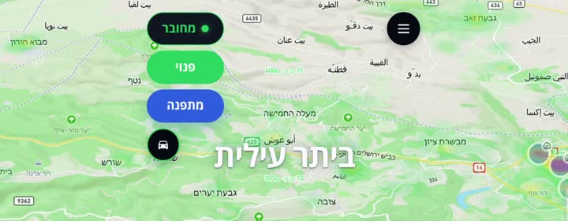
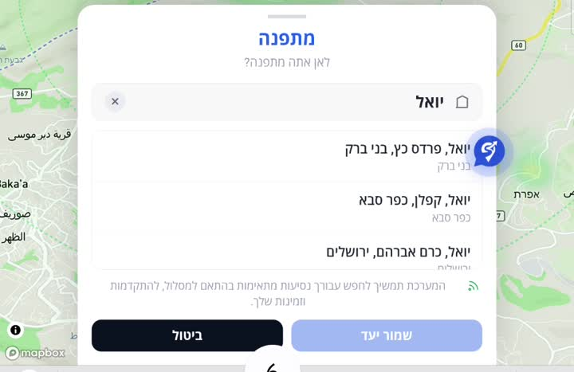
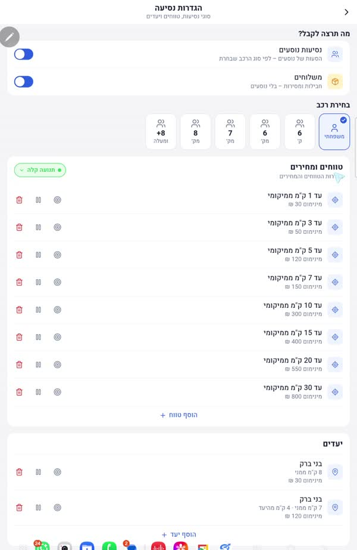
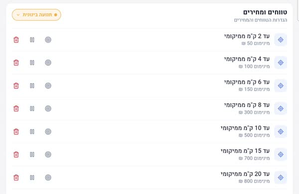
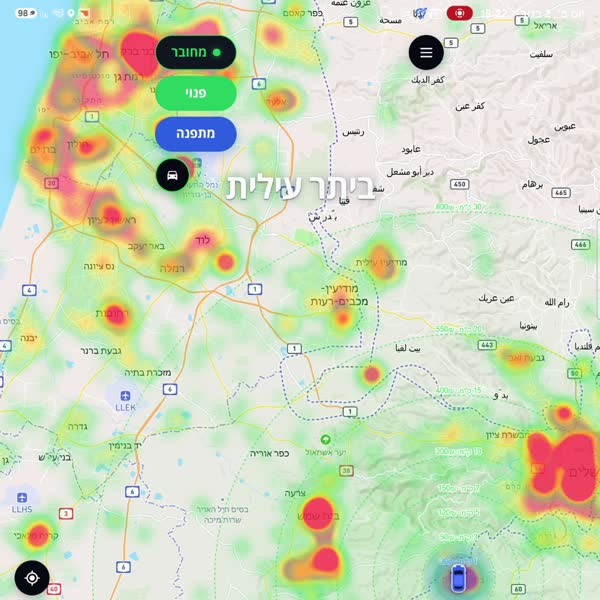
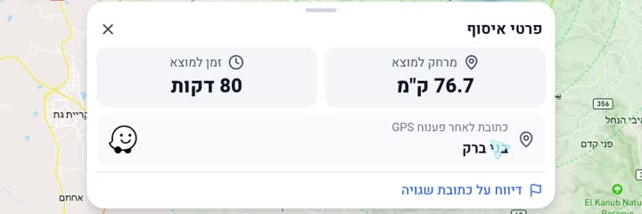
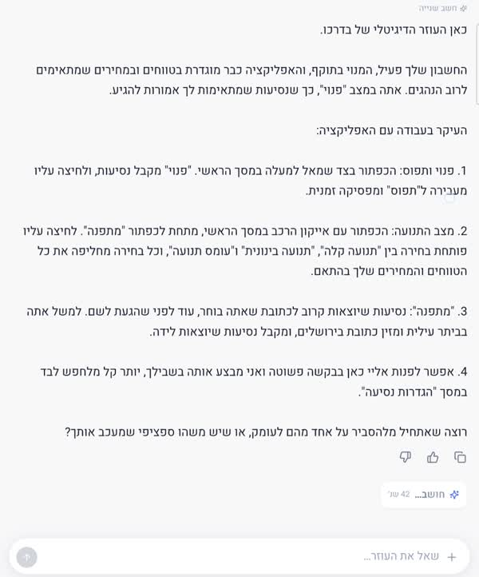
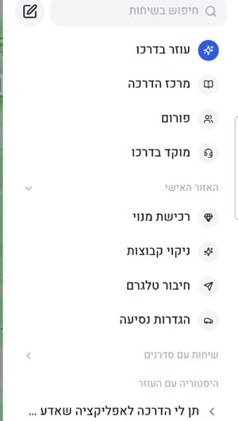

# הדרכה לנהג חדש: עבודה עם אפליקציית בדרכו

**גרסה 1, 2.11.2026.** נכתבה לפי סרטון ההדרכה של דוד על האפליקציה (חלק 1). העותק החי נמצא כ-Claude Doc: https://claude.ai/artifact/3shagRJf2dm7kDqtD14DEx

כדי לקבל נסיעות צריך שלושה דברים: סטטוס **מחובר** ירוק, כפתור **פנוי** ירוק, והגדרות טווחים ומחירים שמתאימות לך. ההדרכה עוברת על המסך הראשי כפתור אחר כפתור, ואחר כך על הגדרות הנסיעה, המפה, הלוג והעוזר הדיגיטלי.

## 1. המסך הראשי

בפינה העליונה יש ארבעה כפתורים, מלמעלה למטה:

| כפתור | מה הוא אומר | מה צריך לראות |
| --- | --- | --- |
| **מחובר** | הסטטוס של המיקום והרשת | ירוק עם המילה "מחובר". אם כתוב "מתחבר", צריך לשפר קליטה של מיקום ורשת |
| **פנוי** | האם אתה מקבל נסיעות | ירוק ו"פנוי" כדי לקבל נסיעות. לחיצה מעבירה ל"תפוס" (אדום) והנסיעות מפסיקות להיכנס |
| **מתפנה** | חיפוש נסיעות מכתובת אחרת, לא מהמיקום שלך עכשיו | כחול. כשהוא פעיל מופיעה בו הכתובת שבחרת |
| **אייקון הרכב** | מצב התנועה שנבחר | צבע המסגרת משתנה לפי מצב התנועה (ירוק = תנועה קלה) |

### איך משתמשים ב"מתפנה"

מתפנה מיועד לנהג שלא רוצה נסיעות מהמקום שבו הוא נמצא עכשיו, אלא מכתובת שהוא עומד להגיע אליה.

1. לוחצים על **מתפנה**.
2. מקלידים כתובת, למשל "יואל 6 ירושלים".
3. בוחרים את הכתובת המדויקת מהרשימה.
4. לוחצים **שמור יעד**. הכתובת מופיעה עכשיו על כפתור מתפנה.

מה קורה מאחורי הקלעים: כל הטווחים והמחירים שלך מחושבים עכשיו **מכתובת המתפנה** ולא מהמיקום החי שלך. למשל, אם הגדרת "עד 1 ק"מ, מינימום 30 ₪", תקבל נסיעות עד 1 ק"מ מיואל 6 בירושלים.

כדי לחזור לקבל נסיעות מהמיקום החי, לוחצים שוב על מתפנה ומבטלים אותו.

## 2. הגדרות נסיעה

כאן קובעים איזו נסיעה תגיע אליך ובאיזה מחיר. נכנסים דרך התפריט (שלוש השורות למעלה) אל **הגדרות נסיעה**.

במסך יש:

- **מה תרצה לקבל:** נסיעות נוסעים ו/או משלוחים.
- **בחירת רכב:** משפחתי, 6 ק׳, 6 מק׳, 7 מק׳, 8 מק׳, 8+ ומעלה.
- **טווחים ומחירים:** לכל מרחק ממך לנקודת האיסוף, המחיר המינימלי שאתה מוכן לקבל.
- **יעדים** ו**חיפושים מתקדמים:** חיפושים נוספים לעיר או למסלול מסוים (יוסבר בחלק הבא של ההדרכה).

### איך עובדים הטווחים והמחירים

נסיעה נכנסת רק אם המחיר שלה לפחות המינימום שהגדרת למרחק שלה ממך. המרחק נמדד מהמיקום החי שלך (או מכתובת המתפנה, אם הוא פעיל).

דוגמאות לפי ההגדרות שבתמונה:

- נסיעה של 30 ₪ עד 1 ק"מ ממך: **נכנסת**.
- נסיעה של 100 ₪ במרחק 5 ק"מ: **לא נכנסת**, כי המינימום שם הוא 120 ₪. נסיעה של 150 ₪ באותו מרחק כן נכנסת.
- נסיעה של 120 ₪ במרחק 7 ק"מ: **לא נכנסת**, כי שם צריך לפחות 150 ₪.

### מצב תנועה

כשיש פקקים, קילומטר אחד יכול לקחת 20 דקות, ולכן כדאי לבקש מחיר מינימום גבוה יותר לכל קילומטר. לכל מצב תנועה יש סט טווחים ומחירים משלו: **תנועה קלה**, **תנועה בינונית** ו**עומס תנועה**. מחליפים מצב באייקון הרכב במסך הראשי או בכפתור המצב במסך ההגדרות.

| מרחק לאיסוף | תנועה קלה (מינימום) | מרחק לאיסוף | תנועה בינונית (מינימום) |
| --- | --- | --- | --- |
| עד 1 ק"מ | 30 ₪ | עד 2 ק"מ | 50 ₪ |
| עד 3 ק"מ | 50 ₪ | עד 4 ק"מ | 100 ₪ |
| עד 5 ק"מ | 120 ₪ | עד 6 ק"מ | 150 ₪ |
| עד 7 ק"מ | 150 ₪ | עד 8 ק"מ | 300 ₪ |
| עד 10 ק"מ | 300 ₪ | עד 10 ק"מ | 500 ₪ |
| עד 15 ק"מ | 400 ₪ | עד 15 ק"מ | 700 ₪ |
| עד 20 ק"מ | 550 ₪ | עד 20 ק"מ | 800 ₪ |
| עד 30 ק"מ | 800 ₪ | | |

אלה הגדרות הדוגמה מהסרטון. כל נהג קובע לעצמו את הטווחים והמחירים, מוסיף טווח ב"הוסף טווח" ומוחק בפח האדום.

## 3. המפה

על המפה רואים נסיעות מכל הארץ, גם כאלה שלא מתאימות להגדרות שלך. אזור אדום במפת החום הוא אזור עם הרבה נסיעות. כשמקרבים את המסך על האזור האדום מופיעות בועות הנסיעות עם האייקונים, וכך רואים איפה יש אזורי עבודה פעילים.

| עיגול על המפה | סוג הנסיעה |
| --- | --- |
| כתום עם אייקון של קרטון | משלוח |
| כחול עם אייקון של בית | נסיעה פנימית, בתוך אותה עיר (למשל ירושלים-ירושלים) |
| סגול | נסיעה בין עירונית (למשל מביתר לשערי צדק בירושלים) |

- **נסיעה חדשה מהבהבת** בערך חצי דקה ומוצגת עליה בועת "נסיעה חדשה". אחר כך העיגול נשאר קבוע, עד שהנסיעה נעלמת מהמפה.
- **לחיצה על עיגול** פותחת בועה עם פרטי הנסיעה: המיקום שלך, איפה הלקוח ולאן הוא נוסע.
- **כפתור פוקוס מיקום** (העיגול השחור עם הכוונת, בצד שמאל) מחזיר את המפה למיקום שלך, גם אם התרחקת כדי לחפש נסיעות.

## 4. עדכונים חיים, לוג נסיעות ובקשת נסיעה

המפה מציגה את כל הנסיעות, אבל העדכונים החיים והלוג מרכזים רק את הנסיעות שמתאימות להגדרות שלך.

- **עדכונים חיים:** כל נסיעה רלוונטית חדשה קופצת כאן עם התראה. **נקה הכל** מנקה את הרשימה.
- **לוג נסיעות** (בתחתית המסך, עם מספר הנסיעות): כל הנסיעות הרלוונטיות נשמרות כאן, ואפשר לחזור אליהן. נסיעה שלוחצים עליה במפה לא נכנסת ללוג, אבל אפשר לראות את הפרטים שלה ולבקש אותה כרגיל, כמו נסיעה מהלוג.

כל כרטיס נסיעה מציג: שם הקבוצה, שם הסדרן, השעה, הנוסח המקורי של ההודעה וכפתור **לסדרן**.

### פרטי איסוף

לחיצה על נסיעה בלוג פותחת את חלון פרטי האיסוף, ועל המפה מסומן המסלול אליה.

- **מרחק למוצא** ו**זמן למוצא:** כמה רחוק אתה מנקודת האיסוף.
- **כתובת לאחר פענוח GPS:** הכתובת שהמערכת הבינה מההודעה. משווים אותה לנוסח המקורי.
- **דיווח על כתובת שגויה:** לוחצים כשהפענוח לא נכון.
- **אייקון Waze:** פותח ניווט לכתובת המפוענחת. שימו לב: אם בהודעה המקורית כתובה רק עיר (למשל "בני ברק") בלי רחוב, Waze ייפתח על נקודה כלשהי בעיר. רק כשיש רחוב בהודעה הוא יוביל לכתובת המדויקת.

**חשוב:** המרחק והזמן למוצא מחושבים כרגע בקו אווירי ישר, ולכן הם לא מדויקים. על נסיעה שנראית לך טובה, בדוק את הזמן ב-Waze. הנתון כן נותן אמת מידה להשוואה בין נסיעות, ובהמשך ישודרג לחישוב מדויק יותר.

### איך מבקשים את הנסיעה

לוחצים על **לסדרן** בכרטיס הנסיעה. הפנייה עוברת לסדרן שפרסם אותה. כשהנסיעה מגיעה מבוט (למשל דרייבוט), הפנייה נפתחת כרגע בוואטסאפ, ובהמשך זה יעבור לטלגרם.

## 5. העוזר הדיגיטלי והתפריט

הבועה הכחולה שמהבהבת בצד המסך פותחת את **עוזר בדרכו**. אפשר לכתוב לו במילים פשוטות, למשל "תן לי הדרכה איך מתחילים לעבוד", או לבקש ממנו לשנות הגדרות, כמו הוספת יעד "ירושלים 5 ק"מ ממני". התשובה עלולה לקחת כמה דקות.

התפריט (שלוש השורות למעלה) מרכז את שאר הכלים: עוזר בדרכו, מרכז הדרכה, פורום, מוקד בדרכו, רכישת מנוי, ניקוי קבוצות, חיבור טלגרם, הגדרות נסיעה, שיחות עם סדרנים והיסטוריית השיחות עם העוזר.

## 6. בדיקה מהירה לפני שמתחילים

- [ ] כתוב **מחובר** בירוק
- [ ] הכפתור מראה **פנוי** בירוק
- [ ] הגדרת סוג עבודה (נוסעים / משלוחים) וסוג רכב
- [ ] הגדרת טווחים ומחירים שמתאימים לך
- [ ] נבחר מצב תנועה שמתאים למצב הכביש עכשיו
- [ ] מתפנה כבוי, אלא אם אתה בדרך לכתובת אחרת
